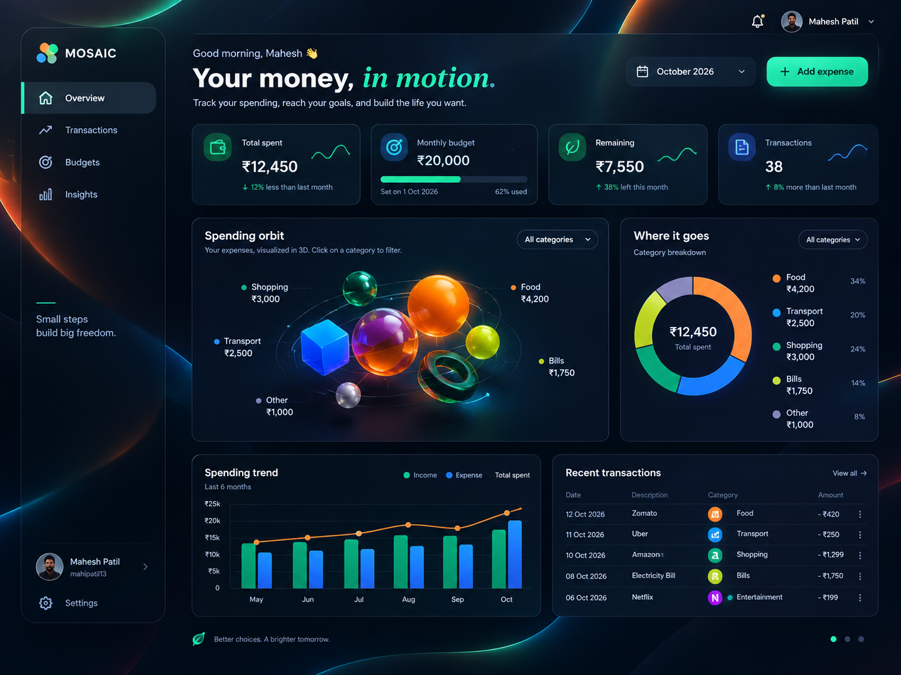

# MOSAIC — 3D Expense Tracker PRD

Product Requirements Document · Version 1.0 · October 2026

## 1. Product vision

MOSAIC is a modern, easy-to-use personal expense tracker that helps people understand where their money goes through a beautiful dashboard, simple expense management, and interactive 3D visualizations.

The core principle: simple finance tracking, exceptional design. The app should look premium and futuristic without making users learn complicated financial tools.

[Recraft V4.1 Utility • AI Image Generation Explorer | Artificial Analysis](https://images.openai.com/static-rsc-4/O-7qEmi9ma9Tf4tfbajNsyfkB9PwmwDaAImcRKYX04rqsFX71DtNGz2-fKlYFC0ZEY-mK1v9wxKjXc2OCvscIK3VVeR9XQMqL5GmYu-yOgHOp3nsYs-NmkgLH2OZPyI-RO7CkQOX-H2-DKk5PUsU-wj2Opv_mBHYnTJ6vxEQMu8?purpose=inline)

[artificialanalysis.ai](https://artificialanalysis.ai/image/explore/model/recraft-v4-1-utility)

## 2. Target users

- Students who want to track daily spending.
- Young professionals who want to manage monthly budgets.
- Anyone who wants a visual, simple overview of their expenses.

## 3. Main product requirements

Keep the application focused on one main dashboard and two essential workflows: managing expenses and setting a budget.

| Feature            | Requirement                                                            |
| ------------------ | ---------------------------------------------------------------------- |
| Dashboard          | Show spending, monthly budget, remaining budget, and transaction count |
| Add expense        | A simple form with amount, description, category, and date             |
| Expense history    | A searchable, filterable list of recent expenses                       |
| 3D spending orbit  | Colorful interactive objects represent spending categories             |
| Spending breakdown | One donut chart showing where money goes                               |
| Spending trend     | One simple chart showing spending over the last six months             |
| Monthly budget     | Set or update a budget and see how much remains                        |
| Data persistence   | Save expenses so they remain after refreshing or logging in again      |

No separate analytics hub, AI chatbot, social feed, complicated reports, or unnecessary tables in the initial release.

## 4. Visual design requirements

The reference design is the source of truth.

Dark futuristic background

Deep navy and near-black surfaces, with subtle neon curves, soft glows, and a sense of depth.

Glass-effect cards

Translucent navy panels, thin blue-grey borders, rounded corners, and restrained shadows.

Purposeful accent colors

Mint for positive financial signals, orange for spending highlights, blue for transport and analytics, with green, lime, and teal for category objects.

Avoid excessive gradients, too many glowing elements, oversized animations, and unnecessary decoration. The interface should remain clear and readable.

## 5. Page structure

The dashboard contains only these important sections:

1\. Sidebar

Logo, Overview, Transactions, Budgets, profile, and Settings.

2\. Summary cards

Total spent, monthly budget, remaining amount, and number of transactions.

3\. Spending orbit

The main visual feature: interactive 3D category objects that update when selected.

4\. Spending insights

One category donut chart and one six-month spending trend chart.

5\. Recent transactions

A compact list of recent expenses with category, amount, date, and edit/delete actions.

## 6. User experience and navigation

- The Add expense button stays visible near the top of the dashboard.
- Adding an expense opens a small modal rather than a separate complicated page.
- Selecting a 3D object filters the relevant charts and transaction list.
- Month selection updates all summary cards and charts consistently.
- The Transactions navigation item opens the full searchable expense list.
- The Budgets item opens a simple page for viewing and changing the monthly budget.
- Settings contains only essential options such as currency and account management.

### Add expense form

Required fields:

- Amount
- Description
- Category
- Date

Optional: payment method.

Use clear labels, inline validation, a visible Save button, and a success message. Avoid lengthy forms.

## 7. Recommended technology

| Layer                       | Choice                          |
| --------------------------- | ------------------------------- |
| Framework                   | Next.js App Router + TypeScript |
| Styling                     | Tailwind CSS                    |
| 3D                          | Three.js + React Three Fiber    |
| Charts                      | Recharts                        |
| Icons                       | Lucide React                    |
| Authentication and database | Supabase                        |
| Hosting                     | Vercel                          |

Use the official [Next.js App Router documentation](https://nextjs.org/docs/app) and [Supabase Next.js guide](https://supabase.com/docs/guides/getting-started/quickstarts/nextjs) for implementation.&#x20;

[image](https://www.google.com/s2/favicons?domain=https://nextjs.org\&sz=32)

Next.js

+1

## 8. Data and security

Keep the database simple:

- Expenses: owner ID, amount, description, category, date, payment method.
- Budgets: owner ID, month, budget amount.
- User profile: currency and basic preferences.

Requirements:

- Each user's records must be private.
- Enable PostgreSQL Row Level Security and enforce ownership on every read and write.
- Validate expense amounts and form inputs on the server.
- Keep secrets out of frontend code and GitHub.
- Store financial values accurately and use one consistent currency per account.
- Never rely on hardcoded demo values for actual calculations.

Supabase documents authentication and database access controls for Next.js applications.&#x20;

[image](https://www.google.com/s2/favicons?domain=https://supabase.com\&sz=32)

Supabase Docs

+1

## 9. Performance requirements

- Load the 3D scene without blocking the rest of the dashboard.
- Use lightweight geometry, limited lighting, and restrained animations.
- Provide a static or 2D fallback when WebGL is unavailable.
- Support mobile screens and touch interactions.
- Respect reduced-motion preferences.
- Show loading, empty, and error states clearly.

## 10. Development milestones

1. Milestone 1 — UI: Build the dark dashboard to match the reference image, using clearly labeled demo data.
2. Milestone 2 — Expenses: Implement adding, editing, deleting, searching, and filtering expenses.
3. Milestone 3 — Visualizations: Add the 3D spending orbit and two interactive charts.
4. Milestone 4 — Persistence: Connect Supabase authentication, database tables, and security policies.
5. Milestone 5 — Launch: Test calculations, mobile layouts, security, and production deployment.

## 11. Definition of done

MOSAIC is ready for its first release when a user can:

- Sign up and securely access their account.
- Add, edit, delete, and find expenses.
- Set a monthly budget and see accurate remaining funds.
- Explore category spending through the 3D orbit and charts.
- Refresh or sign in again without losing saved transactions.
- Use the application comfortably on both desktop and mobile.

Final scope decision: Build the dashboard, expense management, budget setting, and visualizations well. Leave bank integrations, AI features, complex reports, recurring payments, and other nonessential functionality for later. The goal is a small, polished, genuinely useful product—not a dashboard crowded with features. take this image reference to build the ui